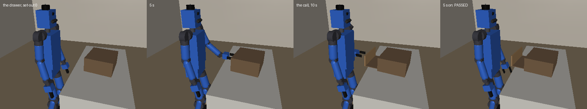

# Hands — the humanoid's manipulation vocabulary

The verbs a mind writes a procedure in to work with the humanoid's hands
(issue #525): the verb set, what each says and how it fails, the language
around it, the capability check that gates it, and the migration from
#493's practice verbs. Every demo after #493 (#465) and #487's skill
library stand on this vocabulary.

Read alongside:
- `docs/SimNotes.md`, "The force move (issue #525)" and "Stepping toward
  the work" -- how each number here was measured. This doc says what the
  constraint is.
- `docs/Challenges.md` §10 -- the three new checks' graders.
- `docs/Evaluation.md` §4 -- practice first, and the arms the vocabulary
  replaces.
- `procedure/steps.py` (`HANDS_VERBS`, `hand_facts`) and
  `humanoid/reach.py` (`Reach.pull`): the code. The verbs' own text is what
  a mind is shown; this doc does not repeat it.

---

## 1. What was studied

**Robot motion primitives.** Industrial controllers move a tool by joint
(MoveJ), along a line (MoveL), an arc (MoveC) or a path of points blended
into one motion (MoveP). Contact work adds three kinds of force control: a
GUARDED move (a position move that stops on a force), a FORCE MODE (UR's:
the tool pushes with a set force along chosen axes and is position
controlled along the others), and HYBRID position/force control (Raibert
and Craig 1981), which splits the task frame into the directions a contact
constrains and the ones it leaves free -- Mason's (1981) natural and
artificial constraints. Impedance control (Hogan 1985) makes the arm a
spring; admittance closes a loop on a measured force and moves the
command. Kröger, Finkemeyer and Wahl's manipulation primitives are a hybrid
move plus a stop condition, the unit a program is built from. Opening doors
and drawers without a model of them (Karayiannidis et al. 2013; Jain and
Kemp's equilibrium point control) comes down to letting the mechanism's
constraint steer a compliant hand and reading the way it went.

**Human manipulation.** Cutkosky (1989) and Feix et al.'s GRASP (2016) sort
grasps by power against precision and by which surfaces of the hand
oppose; a two-jaw gripper has one, the pad-against-pad pinch. Bullock, Ma
and Dollar (2013) sort manipulation by contact, whether it is prehensile,
whether the hand moves, and whether anything moves within the hand -- a
light grip that lets a held object turn between the pads is "within hand,
motion at contact". Non-prehensile work (Mason; Lynch: push, slide, pivot,
tilt) is what a hand does without grasping. Two hands together (Guiard
1987; Krebs and Asfour 2022) usually divide into a hand that holds a frame
and a hand that works in it.

**This body.** Two Unitree Dex1-1 two-jaw grippers (90 mm stroke, 5-120 N a
pad, adjustable: `humanoid/parts.py`), each on a six-joint arm whose grip
reaches 0.58 m from a shoulder 1.15 m up; the hand's force read off its
arm's motor currents through the robot's model of itself (within 0.5 N of
the truth held still: SimNotes); the grip's own word -- its jaws' gap and
squeeze; the head camera's tags (a face's middle, which way it looks, which
way its edges run); the D435's depth (`measure`); a posture -- the
pelvis's height and the trunk's pitch -- that the standing policy holds;
and its feet, which the walking policy moves.

## 2. The principles

1. **Two kinds of hand move, and only two.** A POSITION move puts the hand
   where it is told (`reach`, `move_hand`, `withdraw`). A FORCE move pushes
   with a force along a way and lets what the hand holds take it (`pull`):
   the one thing no composition of position moves can do, because its loop
   closes on what the hand feels every command (100 a second), inside the
   verb. A procedure's loop runs between verbs (100 rounds, 200 verb calls
   at most); a hinge's steer needs every command. The feet have a move of
   their own, `step`, with the hands home and empty.
2. **Every report is a sensor, every failure readable.** What a verb did
   rides `read(...)`, and `if verb(...)` reads its failure without ending
   the procedure.
3. **No verb knows a job** (Ben's call 2 on #493). No verb is a lid, a
   drawer, a door or a swing; each is generic, for any object.
4. **A verb earns its place by doing what no composition can.** A swing is
   a path and the maths; a re-aimed pull is two pulls and a `read`. Those
   are skills a robot writes for itself (#487, demo 3).
5. **The posture is the body's; where it stands is the procedure's.** Every
   hand verb chooses the posture its whole motion is followed from, and a
   procedure never names one; `step` moves the feet, and the hand verbs
   take their postures from where they then stand.

## 3. The verbs

| verb | what it does | its report | how it fails | built from |
|---|---|---|---|---|
| `spot(tag)` | stands still and looks for a tag -- as it stands, then bowing lower (`SPOT_GAZES`) until it sees it -- and stands up again | `spot.x/y/z` (the face's middle), `spot.nx..nz` (into the thing it is on), `spot.ex..ez` (along an edge), `spot.range` | not in view from where it stands | the head camera's tag detector (`rack.tags`), `Body.gaze_routine` |
| `measure(x, y)` | the depth camera's look at what stands at (x, y) | `object.top/near/far/left/right` | no flat top seen | the D435's cloud (`perception/box.py`) |
| `reach(hand, x, y, z, fingers, jaws, stiffness)` | the grip to a point, turned as asked or as the arm finds; out to a point short of it, then in along the fingers | `hand.x/y/z`, `hand.fx..fz` | out of reach (and whether the other hand could, as asked or turned another way), turned as asked or not; stopped short. ⚠ What it touches on its way in under the blocking force can hold it a few cm short while it holds: the hand's place says where (§5) | the arm's IK on the robot's model of itself, a planned posture |
| `via(hand, x, y, z, turn)` | adds a point to the hand's next move; nothing moves | -- | a path holds 40 points | -- |
| `move_hand(hand, x, y, z, speed, stiffness, turn)` | a hand that is out carried along a line, or through its `via` points, as ONE motion from one posture | as `reach` | out of reach (planned or partway), held back | `Reach.carry`, `path_for` |
| `pull(hand, dx, dy, dz, force, distance, speed, give)` | THE FORCE MOVE (§4) | `pull.moved`, `pull.force` (the hardest along its way, as felt), `pull.dx..dz` (the way the hand was going at its end) | ok whenever it pulled; why it stopped (distance, held fast, let go, out of reach, feet moved) is the record's | `Reach.pull` |
| `close_hand(hand, force)` | shuts the gripper with at most `force` a pad, 5-120 N | `hand.held`, `hand.gap` | closed on nothing it holds | the Dex1-1's torque limit, its encoder and current |
| `open_hand(hand)` | opens the gripper | -- | -- | -- |
| `withdraw(hand)` | the hand back along its way in, then the arm home: straight, or out to its side first and lowered there where that keeps the arm higher in front of the robot than straight would (SimNotes, "The way home"); ok once its drivers read it home | -- | not home by `RELEASE_S` (something holds it); a fall | `Reach.way_home` on the robot's model of itself, `Reach.home` |
| `step(ahead, left, turn)` | the feet to the work, its hands home first: a turn on the spot, then a walk in the frame it then stands in -- one motion, or ahead then left where the walker would skew it -- and a stand; a walk goes at least a stride, about 10 cm | `step.dx/dy` (where the stance went, in the frame it stood in before), `step.turn`; the verb's text turns a place read before into the frame after | holding something (nothing moves), blocked, fell, out of time. ⚠ A turn's shuffle moves the feet 2-6 cm the report does not count | the walking policy, the legs' odometry |

Beside them stay `wait` and `move(axis, target)` -- the motor level, one arm
joint walked to a setpoint -- and the sensors `time` and each hand's place,
force, `held` and `gap`. A verb that never ran leaves no reading behind,
and a humanoid with a hand out keeps its posture to look (a bow would carry
the hand with it).

**The language** is the served robots' (`procedure/lang.py`), with two
switches on wherever there are hands (`steps.hand_facts`): a verb may be an
`if`'s test (`WorldFacts.verb_tests`), and an expression may call `sin`,
`cos`, `atan2` and `sqrt` (`WorldFacts.math`). Its caps are unchanged:
1,500 characters, nesting 4, `for` over a literal count of at most 100,
`while` stopped at 100 rounds, 200 verb calls, the budget's seconds.

## 4. The force move

`pull(hand, dx, dy, dz, force, distance, speed, give)`, in
`Reach._pulled` every command:

- **Along its way, the force is CLOSED on what the hand feels**
  (admittance): the command walks at `speed` while the hand pushes under
  half `force` along the way, slows to a stand as it reaches it, and backs
  off past it -- `speed * clip(2 (force - along) / force, -1, 1)`, the
  reading smoothed over `ADMIT_SMOOTH_S` -- and leads the hand by
  `LEAD_MAX_M` at most. ⚠ Never the arm's spring as a force cap: its model
  put three times the limit on a drawer's stop.
- **Across it, GIVING (`give` 1), the hand goes where what it holds pushes
  it**: the command follows the hand across the way, no faster than
  `ACROSS_SPEED` times its speed -- hybrid force and position, the hinge
  or the runners steering. ⚠ Unbounded, a lid let go of its weight fell.
- **HOLDING (`give` 0) it keeps its line and its turn**: a set-down.
  ⚠ Giving, a cube set down slid 13 cm along what it touched.
- **Its turn gives to what it holds** (`GIVE_RATE` of the gap a command),
  **but never about the jaws' own line**: what a two-jaw grip holds turns
  about that line between the pads (a light grip lets it), and a lid's
  weight bent the wrist about it, the give following it down and out of
  reach. ⚠ Held about every axis, the pads dragged a drop handle's knob
  sideways through its pin.
- **Its posture** is the one from which the hand reaches the way's end,
  taken before it moves; going on where the arm misses its command, it
  takes ANOTHER posture from the arm as it is, never one it has left this
  move (`posture_for(onward=, past=)`): ⚠ an arm stood at its elbow's stop
  short of its way while a fresh seed of the same posture "reached".
- **It stops** at `distance` along its way ("distance"); held fast -- the
  hand moved under `FAST_M` in `FAST_S` pushing at least `FAST_SHARE` of
  its force; a grip it began with lost ("let go"); out of reach; its feet
  moved; out of time. Then it holds where the hand is.
- **Its report** is how far it went, the hardest it pushed along its way
  as the hand felt it, and the way the hand was going over its last
  `TRAIL_M` -- what the mechanism allowed, which a procedure re-aims by.

A drawer is one pull straight out; a lid one pull up and a little back,
the hinge steering the hand round the arc, and one down toward the body; a
door one pull toward the body and one along the way the hand went. None of
them needs the mechanism's geometry, and none was handed it.

**The grip's force** is the other half of compliance: `close_hand(hand,
force)` shuts with 5-120 N a pad (the Dex1-1's range), and `held` reads the
squeeze against half the force asked -- ⚠ its running mean
(`arms.SQUEEZE_S`): one reading's noise misread a light grip. ⚠ At 120 N a
door's lever could not turn in the jaws; at 15 N its tip turns between them
as the door swings.

## 5. The capability check

#493's gate pattern: before any mind flies the vocabulary, a procedure WE
wrote in it, for each generic job, flown at the job's set-outs and graded
by the job's own grader, the bar written first -- **a job passes at 6 of
its 8 set-outs** (`evaluation/hands_check.py`, `BAR`, `SET_OUTS`).

| job | grader | the set-out (`evaluation/counter.py`) | what its procedure knows |
|---|---|---|---|
| lid | `challenge/lid.py`: past 57 deg, set down, let go | #493's chests on the 0.72 m counter | the knob's cube from its tag; lift up and a little back, lower toward the body |
| drawer | `challenge/drawer.py`: 15 cm out, let go | a cabinet on the counter, its knob where a chest's is | pull straight out |
| door | `challenge/door.py`: 50 deg open, let go | a cupboard hinged on its left, its lever's tip 0.40-0.44 ahead | press the lever, let go, look: a door already open is done; else grip it lightly and pull toward the body, then on the hand's way |
| place | `challenge/place.py`: on the mat within 2.5 cm, flat on a face, set down, let go | a cube 0.40-0.46 ahead on a 6 cm board -- in sight, out of reach where the robot stands -- the mat 6-8 cm further | a step in until the cube is 0.32 ahead, what it read turned into the frame it then stands in; grip it from above-front; lift, carry, set down holding the line |

The procedures and what each knows that a mind would have to find out are
in `hands_check.py`; `scripts/hands_check.py --source JOB` prints one.

(`MUJOCO_GL=egl uv run python scripts/hands_check.py --strip JOB 0 --out
docs/figures/hands_JOB.png`; `--view JOB K` watches one in the viewer.)

**The result**, flown from `3b4065e` (`scripts/hands_check.py --jobs 3
--into DIR`): two jobs of four meet the bar.

| job | passed | the set-outs that failed, and why |
|---|---|---|
| lid | **7 of 8** | 2: no tilt's grip held the knob (its reach stopped short, its jaws closed on nothing) |
| drawer | 3 of 8 | 4, 5: no grip, its reaches stopped short (at 4 the jaw's pad on the counter); 2: the pull out of reach 8 mm out; 6, 7: held fast at its 15 N, 2 and 11 cm out |
| door | **6 of 8** | 2: opened 44 deg, its pull out of reach; 4: never opened, its reaches out of reach or stopped short |
| place | 3 of 8 | 2, 4: the carry to the mat out of reach; 5, 7: let fall at 0.6 m/s; 6: set down 3 cm from the mat's middle |

**Our procedures were written against the set-outs they are checked on.**
The review redrew the drawer's, the door's and the cube's set-outs (each
now draws off a stream of its own: off one seed, the cube's hidden weight
was where it stood). On the draws the procedures were written against, the
same code passes the drawer 7 of 8, the door 7 and the cube 4 -- the
set-outs it passed before the review, whose fixes changed no outcome
there. The fresh draws are the first the procedures were not written
against, and where they fail it is the props' geometry against the
gripper's 8 cm fingers, not a missing verb:
- *the drawer*: on the way in to a knob 15 cm over the counter on a 2 cm
  stem, the jaws' pads met the cabinet's top or the counter (the reach
  blocked at 50-65 N), and for some knobs and turns the one grip turn
  the procedure asks is out of reach -- letting the arm find the turn as
  a last try passed no more (4 of 8 on set-outs 8-15 either way);
- *the cube*: the grip point is the fingers' middle, so at a tilt that
  reaches a 26 mm cube on a board the tips meet the board first and the
  jaws pinch its top few millimetres, and it tips or drops as it is let go
  (SimNotes, "Stepping toward the work"). Standing put it passed 3 of 8;
  stepping in, 4 of the draws written against and 3 fresh.

The door's procedure flown over its 32 public set-outs passed 20, its
slowest in 35.8 sim-s, which set the door's own time limit when a mind
practiced it (#535; Evaluation.md §4, "The door, with no new help").

**The props and their set-outs**, each placement's reason at its constant,
are SimNotes' ("The force move", the checks' props).

**What it cannot show.** The check proves the vocabulary EXPRESSES each
job -- each passes some of its set-outs -- not that a mind finds the
expression, nor yet that one procedure holds over draws it was not written
against; it is one body, one hand at a time, on a counter at 0.72 m.

## 6. The migration

**#493's practice verbs:**

| #493 | #525 | |
|---|---|---|
| `spot` | kept | bows lower until it sees; reports the edges' way |
| `measure` | kept | an arm may still go without it (`--no-measure`) |
| `reach` | kept | |
| `move_hand` | kept, MERGED with `follow` | goes through the `via` points first |
| `via` | kept | |
| `follow` | DROPPED | `move_hand` carries a path |
| `pull` | REBUILT as the force move | `stiffness` and the turn dropped (the arm's gains are the move's; its turn gives); `give` added; `force` is a force it pushes with, never a condition it stops on |
| `close_hand` | kept, `force` added | |
| `open_hand`, `withdraw` | kept | |
| -- | `step`, NEW | the feet to the work (§3) |

The practice's arms (`--pull`, `--verb-tests`, `--path`) were the
vocabulary's stages; it is one vocabulary now, `measure` and `step` with
it (`--no-measure`, `--no-step` the arms without), and Evaluation.md §4 keeps the rule that
#493's rows are never pooled with its.

**The served robots' language is unchanged.** The quadruped's procedures
are `VERBS`, and `WorldFacts`' switches are off there (`verb_tests`,
`math`): its procedure rule says "no other calls"
(`overseer.PROCEDURE_HEAD`). Turning either on is a change to the deployed
prompt, so it is its own Observatory period (Observatory.md), decided
apart (Evaluation.md §2); nothing here asks for it, and the hands' verbs
belong to a body the served world does not have. The hands' verbs are a table of their own
(`HANDS_VERBS`) that the language reads only where a world's facts name
them, so a served robot's kept procedure naming a local `pull` still
compiles.

**The practice prompt** (`mind/practice.py`) is built off the facts: the
verbs' text, the sensors, the maths and the verb test are each shown
because the world has them, and none of its rules prescribes a job (a test
reads them). Stage 3 of #493 flew on it twice (Evaluation.md §4,
"Practice first on the hands' vocabulary"): neither arm passed a practice
chest, and both lost the grip -- the grasps they chose, not the verbs
under them. With the reach's reply fixed, an arm's frozen copies passed
22 of 29 held-out chests within 3 (§4's "What changed the grasp"). With
no new help, two arms learned the cupboard's door on it: 15 of 22 and 22
of 29 within 3, one of them falling in every try (§4's "The door, with
no new help") -- tries a fall now fails (#544).

## 7. What it does not do

- **Two hands at once.** Every verb is one hand's; a bimanual frame-and-work
  split waits for a job that needs it.
- **Motion within the hand** beyond a light grip's turn between the pads.
- **Contact without a grip** other than pushing with a pull (a negative
  way): no slide or pivot verb, nor yet a job needing one.
- **A walk with something in hand.** A step carries nothing: the walking
  policy walks with its arms home.
- **A way home that looks, or feels.** The way home is judged on the
  robot's model of itself alone (#539): it takes what the hand worked over
  to lie under it ahead of the robot's front, and the space at its side to
  be clear. Nothing checks either against the depth picture: an arm with
  none of it ahead, as over its head, comes home straight through whatever
  stands there, and a hand still caught on something after the line out
  takes it along (a jaw left under a knob lifted a shut lid). A guard on
  the hand's force could not yet tell that from a blocked reach's press
  (SimNotes, "The way home").
- **A small thing low down, or a knob on a short stem.** The fingers are 8
  cm and the grip point their middle, so their tips meet the surface before
  a steep grip reaches a small object's middle (§5).
- **A reading of how far what it holds has turned** (a lid's angle, which
  every arm of #493 said it lacked). Measured off the hinge's own sensor at
  chests 0-7, the robot's own readings carry it, each in one phase: its
  hand's place about the hinge `measure` finds, to a median 1.3 deg as a
  lid opens but 10-16 deg off above 60 deg coming down; the way its last
  pull went (`pull.d*`), to 4 deg coming down but not above 60 opening up.
  A plane fitted to the D435's points is sub-degree where it fits, but the
  trunk's camera, pitched 40 deg down, saw the lid at 45 stops of 55 opening
  and 17 of 33 lowering: a raised lid leaves its view.
